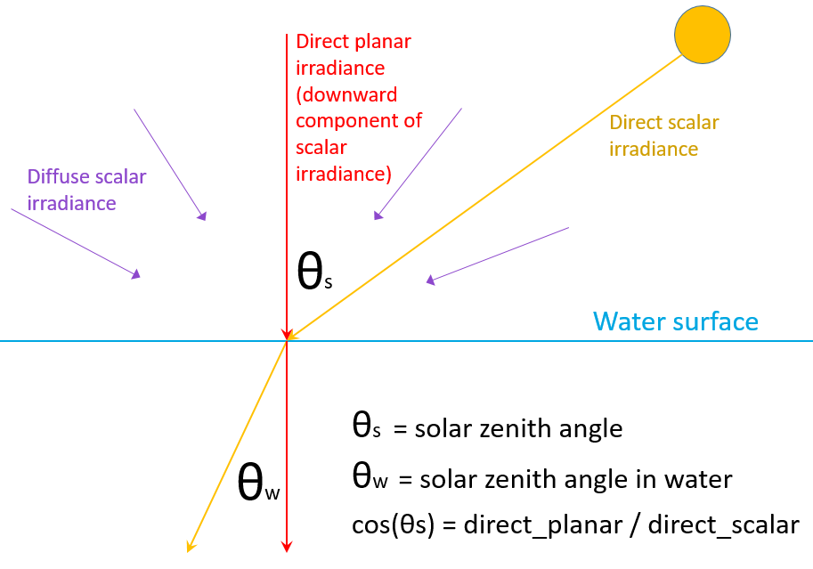
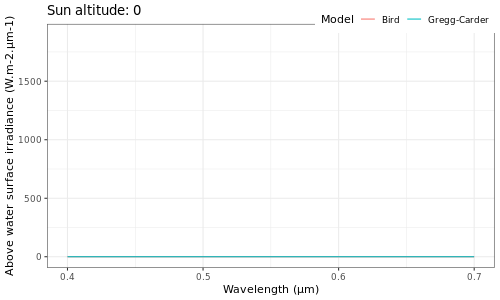

```{r setup, include=FALSE}
knitr::opts_chunk$set(echo = FALSE, message = FALSE, warning = FALSE)

library(ggplot2)
library(dplyr)
library(raster)
library(patchwork)
library(oceancolouR)

filename <- "201807_satPAR_scaling_test.rda"

xlims <- c(-95,-42)
ylims <- c(39,82)

# To get the PAR results for an image:
#
# 1. Make the following temporary changes to these scripts:
#
# run_PP.R:
#       stop() after "result" is calculated
# 03b_BIOv2_model.R:
#       return(presolved) in full_PP_calc() after presolved is calculated
# PAR_resolved:
#       after surface_irr_c and E variables retrieved:
#           planar_factors <- c(SatPAR,mean(Ed,na.rm=TRUE)*100)
#           Ed <- Ed/cos(zendR*pi/180) # scalar direct and diffuse, above water surface
#           scalar_factors <- c(SatPAR * 1.193, sum(Watt_per_m2_to_Mol_per_m2_perhour(Ed, lambda), na.rm=TRUE))
#           return(c(planar_factors, scalar_factors))
#       * don't forget to set other "return" calls in the function to return(c(NA,NA,NA,NA))
# 
# 2. Run this code:
# 
# y_list <- 2018
# m_list <- 7
# biov1_date <- "201807"
# uniform_profile <- TRUE
# use_constant_alphab <- use_constant_pmb <- FALSE
# source("run_PP.R")
# df = data.frame(t(result),stringsAsFactors = FALSE)
# colnames(df) <- c("SatPAR_planar", "GC_Ed_planar", "SatPAR_scalar", "GC_Ed_scalar")
# df <- dplyr::left_join(data.frame(bin=nwa_bins_4km, stringsAsFactors = FALSE),
#                        dplyr::bind_cols(input, df) %>%
#                            dplyr::select(bin, chl, alphab, pmb, SatPAR_planar,
#                                          GC_Ed_planar, SatPAR_scalar, GC_Ed_scalar),
#                        by="bin") %>%
#     dplyr::mutate(planar_fraction=SatPAR_planar/GC_Ed_planar,
#                   scalar_fraction=SatPAR_scalar/GC_Ed_scalar) %>%
#     dplyr::mutate(diff=scalar_fraction-planar_fraction)
# save(result, df, file=filename, compress=TRUE)

```

*BIOv1 = BIO primary production model, version 1*  
*BIOv2 = BIO primary production model, version 2*  

**Investigating differences in light levels of the PAR modelled in BIOv1 vs BIOv2**  

In the primary production model, spectral direct and diffuse components of planar surface irradiance at hourly intervals are modelled using Bird or Gregg-Carder, and then must be scaled to the actual PAR value read by the satellite. First, the units and geometry must be converted to be the same as the satellite PAR value:  


<div class = "row">
<div class = "col-md-6">

1. Satellite PAR is modelled first as planar irradiance in units of mW/cm<sup>2</sup>/um, then converted to scalar irradiance in units of Einsteins/m<sup>2</sup>/day simply by multiplying by a factor of **1.193**.  
2. BIOv1 PAR is modelled first as planar irradiance using Bird in units of Watts/m<sup>2</sup>/um, then converted to scalar irradiance in units of Einsteins/m<sup>2</sup>/day by using the cosine of the solar zenith angle and unit conversions and integration.  
3. BIOv2 PAR is modelled first as planar irradiance using Gregg-Carder in units of Watts/m<sup>2</sup>/nm, and converted to units of mW/cm<sup>2</sup>/um so it can be scaled to the satellite PAR planar irradiance.  

Figure 1 shows the scalar and planar components of light.  

Since BIOv1 uses a different method than satellite PAR to convert from planar to scalar, there are discrepancies between the two. Because of this, the ratio of satellite_scalar / modelled_scalar is different from satellite_planar / modelled_planar, and it can have a noticeable impact on the resulting light and primary production (PP).  

</div>
<div class = "col-md-6">

<font size="5">**Figure 1**</font>



</div>
</div>

Here we'll use Gregg-Carder surface irradiance to compare the differences in these ratios, to get an idea of how much the choice of ratio can affect the resulting light and PP.  

First, the R code used to create the scaling factor after calculating GC light, starting with SatPAR and GC_Ed definitions:  

        # SatPAR = satellite PAR, planar form, units = mW/cm2/um
        # GC_Ed = Gregg-Carder light, planar form, units = Watt/m2/nm

1. Using planar geometry:  
    
        # Unit conversion factor: *1000 (W to mW), /10000 (/m2 to /cm2), *1000 (/nm to /um) = *100
        # Note that in PAR_resolved(), we end up with a matrix where row=hour, column=waveband,
        # so we must take the average light value over the whole day and spectrum to get a
        # result in the same format at SatPAR (a single average "instantaneous" value for the day)
        ScalingPARfactor_planar = SatPAR / (mean(GC_Ed, na.rm=TRUE) * 100)
    
2. Using scalar geometry:  
    
        # First, use the factor from SeaWiFS documentation to convert SatPAR from
        # mW/cm2/um (planar) to Einsteins/m2/day (scalar)
        SatPar = SatPAR * 1.193
        # Now convert GC_Ed from planar to scalar
        GC_Ed = GC_Ed / cos(zendR*pi/180)
        # ... and from Watt/m2/nm to Einsteins/m2/day
        GC_Ed = sum(Watt_per_m2_to_Mol_per_m2_perhour(Ed, lambda), na.rm=TRUE)
        # Create the scaling factor
        ScalingPARfactor_scalar = SatPAR / GC_Ed

<br>
*The comparison is done using data from July 2018*  

```{r}

load(filename)

df = df %>%
    dplyr::mutate(ratio = scalar_fraction/planar_fraction)# %>%
    # dplyr::mutate(PIz_factor_ratio = alphab * ratio,
    #               PIz_factor_scalar = alphab * scalar_fraction,
    #               PIz_factor_planar = alphab * planar_fraction) %>%
    # dplyr::mutate(PP_surface_ratio = chl * PIz_factor_ratio / sqrt(1 + (PIz_factor_ratio/pmb)^2),
    #               PP_surface_scalar = chl * PIz_factor_scalar / sqrt(1 + (PIz_factor_scalar/pmb)^2),
    #               PP_surface_planar = chl * PIz_factor_planar / sqrt(1 + (PIz_factor_planar/pmb)^2))

# r1 <- var_to_rast(df %>% dplyr::select(bin,PP_surface_scalar), ext=c(xlims,ylims))
# r2 <- var_to_rast(df %>% dplyr::select(bin,PP_surface_planar), ext=c(xlims,ylims))

# m1 <- make_raster_map(var_to_rast(df %>% dplyr::select(bin,ratio), ext=c(xlims,ylims)),
#                       cm = oce::oceColorsJet(100),
#                       title = "ScalingPARfactor_scalar / ScalingPARfactor_planar")
m1 <- make_raster_map(var_to_rast(df %>% dplyr::select(bin,diff), ext=c(xlims,ylims)),
                      cm = oce::oceColorsJet(100),
                      title = "ScalingPARfactor_scalar - ScalingPARfactor_planar")

# rstack <- raster::stack(r1,r2)
# names(rstack) <- c("PP_surface_scalar", "PP_surface_planar")
# m1 <- make_raster_map(rstack, cm = oce::oceColorsJet(100), col_limits=c(0,0.1))

# m2 <- make_raster_map(r1/r2,
#                       cm = oce::oceColorsJet(100),
#                       title = "PP_surface_scalar / PP_surface_planar")

# m1 + m2
# m2

```


<div class = "row">
<div class = "col-md-6">

<font size="5">**Figure 2**</font>

```{r echo=FALSE, message=FALSE, warning=FALSE}
m1
```

We can see that *ScalingPARfactor_scalar* is noticeably lower than *ScalingPARfactor_planar*, and decreases with latitude. Also note that this is only the surface layer, so the differences would be even more pronounced after adding up the results at each depth.  

</div>
<div class = "col-md-6">

<font size="5">**Figure 3**</font>


Here we see that Gregg-Carder (used in BIOv2) generally gives slightly higher irradiance values than Bird (used in BIOv1).  
*Note that in an earlier comparison of Bird and Gregg-Carder, the direct component of Bird was mistakenly left in scalar form so the comparison was not accurate - here they are both in planar form.*  
</div>
</div>

<br>


<font size="5">**Figure 4**</font>

<div class = "row">
<div class = "col-md-6">


</div>
<div class = "col-md-6">

<br>
Percent difference between models BIOv1 and BIOv2.  

A) Using *ScalingPARfactor_scalar* for BIOv2, same as BIOv1  
B) Using *ScalingPARfactor_planar* for BIOv2  

**Formula:**  
%diff = 100 * (BIOv2 - BIOv1) / BIOv1  

</div>
</div>

<br>

The combination of the use of the *ScalingPARfactor_scalar* and the Bird model generally makes `BIOv1 <= BIOv2`, as seen in the % difference of the two models in Figure 4B.  

[Note that in Figure 4A, BIOv2 is also using *ScalingPARfactor_scalar*, but the lower % differences and slight latitudinal gradient might be caused by differences in the light geometry in the BIOv1 model, which might be in error and should be addressed later. They could also simply be from legitimate differences in other parts of the primary production models, such as euphotic depth, absorption, backscattering, and attenuation coefficients, and different ways the surface light is adjusted such as using cloud cover fraction]  

---

### Comments

It is likely best to use the planar forms of light to create the scaling factor in order to avoid the uncertainties introduced by the satellite PAR *1.193* factor that converts mW/cm<sup>2</sup>/um to Einsteins/m<sup>2</sup>/day, taken from [SeaWiFS PostLaunch Technical Report](https://oceancolor.gsfc.nasa.gov/docs/technical/seawifs_reports/postlaunch/PLVol22.pdf) Chapter 8.  

<br><br>
