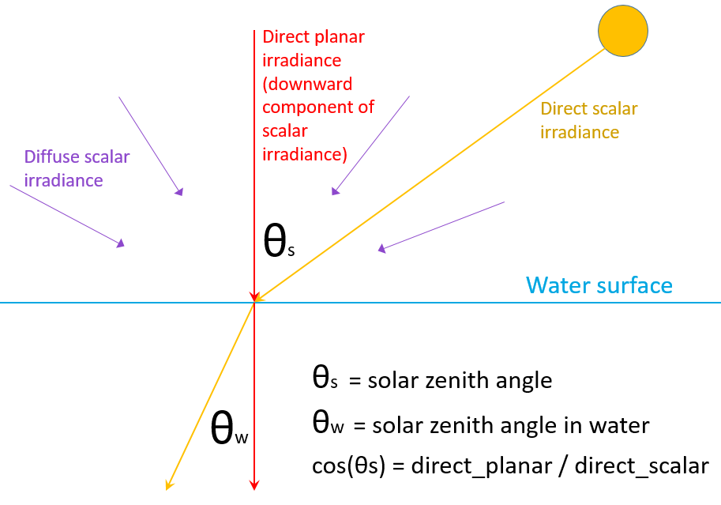
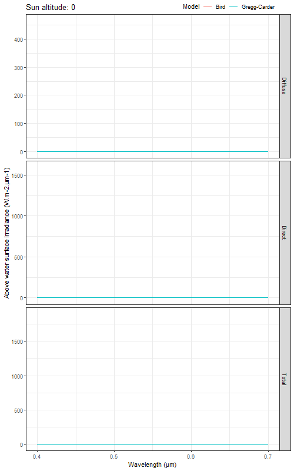
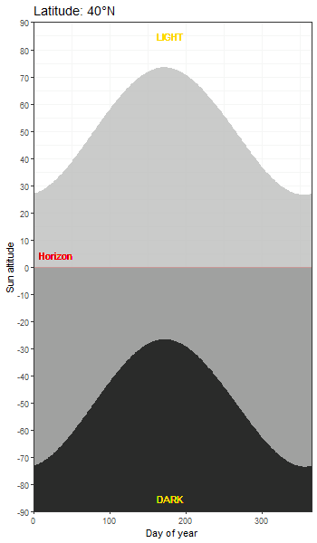

```{r setup, include=FALSE, message = FALSE, warning = FALSE}
knitr::opts_chunk$set(echo = TRUE)

library(ggplot2)
library(stringr)
library(lubridate)
library(patchwork)
library(dplyr)
library(DT)
library(DiagrammeR)
source("../scripts/Gcmod.r")
```

***

# SUMMARY

The latest version of the BIO primary production (PP) model, *BIOv2*, is explained below. The model calculates PP by integrating light over the visible spectrum, at a series of depths and at each hour, then calculating PP and integrating over depth and time. The following boundaries and resolutions are used:  

- 400-700nm wavebands at 1nm intervals  
- 0-120m depth at 0.5m intervals  
- 0-23 hours at 1hr intervals  

The resulting PP is in units of **mg C / m<sup>2</sup> / day**, and is the total primary production per day in the water column, averaged over the time period of the input data (i.e. an 8day period, if the satellite input data is in 8day composites).  


<br>

```{r, echo=FALSE, message=FALSE, warning=FALSE}
DiagrammeR::grViz("
  digraph boxes_and_circles {
  
  # node definitions with substituted label text
  node [shape = rectangle]
  h [label = 'Chlorophyll\nat depth z']
  i [label = 'Solar zenith angle\nat time t']
  {rank = same; h; i}
  j [label = 'Absorption and backscattering\nat depth z']
  k [label = 'Surface irradiance\nat time t']
  {rank = same; j; k}
  l [label = 'Attenuation coefficient\nat depth z']
  {rank = same; l}
  m [label = 'Subsurface irradiance\nat depth z and time t']
  {rank = same; m}
  n [label = 'Primary production\nat depth z and time t']
  {rank = same; n}
  o [label = 'Total daily primary production\nin the water column,\naveraged over 8 days']
  {rank = same; o}
  p [label = 'In situ data']
  q [label = 'Daily satellite PAR']
  r [label = 'Daily satellite CHL']
  {rank = same; p; q; r}
  s [label = '8day satellite CHL']
  {rank = same; s}
  a [label = 'Biomass profile\nparameters']
  b [label = 'Latitude']
  c [label = 'Day of year']
  d [label = 'Hour']
  e [label = 'PI parameters']
  f [label = '8day satellite PAR']
  g [label = '8day gap-filled\nsatellite CHL']
  {rank = same; a; b; c; d; e; f}
  
  # connections
  a -> h
  g -> a
  b -> i
  c -> i
  d -> i
  e -> n
  f -> k
  h -> j
  h -> n
  i -> k
  j -> l
  k -> m
  l -> m
  m -> n [label = 'Integrate over wavelength']
  n -> o [label = 'Integrate over depth and time']
  p -> a
  p -> e
  q -> f [label = 'Arithmetic average']
  r -> s [label = 'Arithmetic average']
  s -> g [label = 'DINEOF to fill gaps']
  
  }
  ",
  height = 700)
```

**Figure 1:** Basic order of operations for the PP model.  


***

# INPUT

## PI parameters

- parameters were calculated from in situ samples, stored in BIOCHEM  

<div style = "width: 75%">
```{r, echo=FALSE}
df <- data.frame(Name = c("alphaB", "PmB"),
                 Description = c("Initial slope of the PI-curve",
                                 "Assimilation number (maximum photosynthetic rate)"),
                 Units = c("C / chl / hr / (Watt / m<sup>2</sup>)",
                           "C / chl / hr"))
DT::datatable(df,
              rownames=FALSE,
              escape=FALSE,
              caption="Table 1: PI curve parameters.",
              options = list(dom = 't',
                             ordering = FALSE,
                             paging = FALSE,
                             searching = FALSE,
                             columnDefs = list(list(className = 'dt-left', targets="_all")))
)
```
</div>

<br>

## Biomass profile parameters

- for non-uniform profiles only  
- modeled by a Shifted Gaussian  
- *h* and *B0* parameters must be scaled by surface chla (given by the satellite)  
- parameters were calculated from in situ samples, stored in BIOCHEM  

<div style = "width: 75%">
```{r, echo=FALSE}
df <- data.frame(Name = c("h", "sigma", "zm", "B0"),
                 Description = c("Parameter controlling the height of the curve",
                                 "Parameter controlling the width of the curve",
                                 "Depth of the maximum height of the curve",
                                 "Background chla"),
                 Units = c("", "", "m", "mg / m<sup>3</sup>"))
DT::datatable(df,
              rownames=FALSE,
              escape=FALSE,
              caption="Table 2: Biomass profile parameters.",
              options = list(dom = 't',
                             ordering = FALSE,
                             paging = FALSE,
                             searching = FALSE,
                             columnDefs = list(list(className = 'dt-left', targets="_all")))
)
```
</div>

<br>


## Satellite data

### CHL

- Units: mg / m<sup>3</sup>  
- 4km-resolution, binned  
- Source: [NASA OBPG](https://oceancolor.gsfc.nasa.gov/atbd/chlor_a/)  
- POLY4-modeled chl (more accurate in the NWA)  
- 8day arithmetic average of daily data  
- Gap-filled using DINEOF  

<br>

### PAR

- Units: Einsteins / m<sup>2</sup> / day  
- 4km-resolution, binned  
- Source: [NASA OBPG](https://oceancolor.gsfc.nasa.gov/atbd/par/)  
- 8day arithmetic average of daily data  


***

# MODEL

## STEP 1: SURFACE IRRADIANCE

<table>
  <tr>
    <td width="30" valign="top"></td>
    <td width="300" valign="top"><br>First, the total surface irradiance must be calculated. This can be separated into its direct and diffuse components, and the planar component of each (i.e. the downward component of the light) can be calculated from the full scalar value by multiplying it by the cosine of the solar zenith angle (Figure 2).<br><br><br><br><br><br><br><br>**Figure 2:** Components of surface irradiance.</td>
    <td width="20"></td>
    <td width="500" valign="top"></td>
  </tr>
</table>
<br>


### Gregg-Carder (GC)

- Units: Watts/m<sup>2</sup>/nm  
- Geometry: planar direct and diffuse components of irradiance.  
- Modified version of the Bird model for use in the Maritimes.  
- Code function includes air-sea interface reflection losses and corrections based on time of year.  
- Cloud-correction not included. Adjusting by cloud fraction changes the amount of light in the direct and diffuse components and the total value, but we're assuming the main effects are accounted for by scaling the modeled values by satellite PAR later.  
- Satellite PAR is in 8day composites but the model requires the day of year to calculate solar zenith angle, so the first day of the 8day composite is used (i.e. days 1, 9, 17, ...)  
- Required input listed below:  

```{r, echo=FALSE}
daypxl <- 150
latipxl <- 50
zenD <- 45

df <- data.frame(Symbol = c("zendR", "lam", "Fo", "oza", "ag", "aw", "nw", "rh",
                            "am", "wv", "wsm", "ws", "vis", "ro3", "p", "p0", "sco3"),
                 Value = c(NA, rep("(Table4)",5),
                           1.34, 0.8, 1, 1.5, 0, 0, NA, 100, 29.92, 29.92, NA),
                 Units = c("degrees","nm","Watts/m<sup>2</sup>/nm",
                           "1/cm","1/cm","1/cm","","","","cm","m/s","m/s","km",
                           "Dobson units","mb","mb","cm"),
                 Description = c("Solar zenith angle, calculated from latitude and day of year",
                                 "Wavebands, 400-700nm in 1nm increments",
                                 "Extraterrestrial irradiance, corrected for Earth-Sun distance, wavelength-dependent",
                                 "Ozone absorption coefficient, wavelength-dependent",
                                 "Oxygen absorption coefficient, wavelength-dependent",
                                 "Water vapor absorption coefficient, wavelength-dependent",
                                 "Refractive index of seawater",
                                 "Default humidity value",
                                 "Aerosol model, 1-10 (default=1, the marine model)",
                                 "Precipitable water",
                                 "Default average wind speed over 24 hours",
                                 "Instant wind speed",
                                 "Visibility (default=15), retrieved from lookup table using satellite PAR in units of mW/cm<sup>2</sup>/um as input",
                                 "Ozone (-99 for climatological ozone)",
                                 "Atmospheric pressure at sea level",
                                 "Reference atmospheric pressure at sea level",
"Ozone scale height, calculated as function of latitude, longitude, day of year, and ro3"))

DT::datatable(df,
              rownames=FALSE,
              escape=FALSE,
              caption="Table 3: Gregg-Carder input.",
              options = list(dom = 't',
                             ordering = FALSE,
                             paging = FALSE,
                             searching = FALSE,
                             columnDefs = list(list(className = 'dt-left', targets="_all")))
) %>%
DT::formatStyle(names(df),lineHeight='80%') 
```

*NOTES:*  

- Lookup table for visibility: `data/LUT_PAR_lati_day_vis.Rdata`  
- Function for *sco3*: `R/Gcmod.R/comp_sco3()`  

<table>
<tr>
<td width="500" valign="top">
```{r, echo=FALSE}
df <- read.table("../data/gcirrad.txt",skip=4,header=TRUE) %>%
    dplyr::filter(between(wavel, 400, 700)) %>%
    dplyr::mutate(Fo = round(sapply(Fobar, solar_irr, jday=daypxl),4)) %>%
    dplyr::rename(lam = wavel, oza=a_O3, ag=a_O2, aw=a_H2O) %>%
    dplyr::select(lam, Fobar, Fo, oza, ag, aw)
DT::datatable(df,
              rownames=FALSE,
              escape=FALSE,
              options = list(dom = 'tp',
                             ordering = FALSE,
                             searching = FALSE,
                             columnDefs = list(list(className = 'dt-left', targets="_all")))
) %>%
DT::formatStyle(names(df),lineHeight='60%') 
```
</td>
<td width="20"></td>
<td width="300" valign="top"><br><br><br>
Table 4: Lookup table for wavelength-dependent Gregg-Carder input.<br>*Fobar* = mean extraterrestrial irradiance in units of *Watts/cm<sup>2</sup>/um*, NOT corrected for Earth-Sun distance.<br>*Fo* = *Fobar* corrected for Earth-Sun distance.<br>Note that the units have to be converted to *Watts/m<sup>2</sup>/nm* to be used as model input.<br>Source: `data/gcirrad.txt`    
</td>
</tr>
</table>
<br>


#### Comparing Bird and Gregg-Carder

<details>
<summary>Click to expand  </summary>

<b>Bird:</b>  

- Units: Watts/m<sup>2</sup>/micron  
- Geometry: scalar direct and planar diffuse components of irradiance.  
- Required input:  
    - Solar zenith angle (in radians)  
    - Waveband (400-700nm, in 5nm intervals)  
- Used in model BIOv1.  
- Assumes cloud fraction = 0
- Code function does NOT include cloud-correction, or corrections for the time of year or reflection losses at the air-sea interface, but these are calculated afterward for comparison to the GC model.  


<div class = "row">
<div class = "col-md-6">

</div>
<div class = "col-md-6">

</div>
</div>

**Figure 3:** Differences between Bird and GC models (left) for each waveband from 400-700nm and sun altitudes between 0 and 80 degrees. On the right, the grey ribbon shows the range of sun altitude over the course of a year for several latitudes across the Northwest Atlantic (NWA) region, to see how the sun altitude and its effects on Bird and GC vary throughout the year.  
</details>
<br>

### Scale surface irradiance by satellite PAR

The modeled surface irradiance must be scaled to PAR calculated by the satellite.  

**Satellite PAR from [NASA OBPG](https://oceancolor.gsfc.nasa.gov/atbd/par/):**  
Single value of scalar irradiance in units of Einsteins/m<sup>2</sup>/day  

**Modeled Gregg-Carder irradiance:**  
Matrix of planar surface irradiance where row = hour, column = waveband, in units of Watt/m<sup>2</sup>/nm  

Convert the model and satellite values to equivalent forms so they can be compared:  

1. SatPAR / 1.193 --> Converts satellite PAR to the average planar irradiance over the entire day and spectrum, in units of mW/cm<sup>2</sup>/um  
2. Convert GC matrix from Watt/m<sup>2</sup>/nm to mW/cm<sup>2</sup>/um  
3. Average each hour interval of GC matrix over waveband  
4. Integrate GC matrix over time, then divide by 24 hours (essentially taking an average over the whole day)  

*See SeaWiFS documentation, PAR code, or Earthdata forum post below for clarification about the satellite PAR value:*  

- [SeaWiFS documentation - PAR documentation on Chapter 8, p46](https://oceancolor.gsfc.nasa.gov/docs/technical/seawifs_reports/postlaunch/PLVol22.pdf)  
- [NASA OBPG PAR code](https://oceancolor.gsfc.nasa.gov/docs/ocssw/calc__par_8c_source.html)  
- [Earthdata forum PAR scaling clarification](https://forum.earthdata.nasa.gov/viewtopic.php?f=7&t=2727&sid=247465f5d784b6a001192a5d498274aa)  

PP model BIOv1 uses the satellite PAR value in its scalar form (i.e. Einstein units) to scale the modeled surface irradiance. See the link below for a comparison of results when scaling GC to the satellite PAR value using values in scalar geometry/units or planar geometry/units:  
[Compare scaling factors](comparing_satPAR_scaling_factors.html)  

**Note about the NASA PAR 1.193 factor:**  
irradiance in Einsteins/m<sup>2</sup>/day =  
[irradiance in mW/cm<sup>2</sup>/um] * 1.193 =  
[irradiance in mW/cm<sup>2</sup>/um] * _[  [0.001 W/mW] * [10000 cm<sup>2</sup>/m<sup>2</sup>] * [0.001 um/nm] * [(2.77&times;10<sup>18</sup>) quanta/s/W] * [1/(6.022&times;10<sup>23</sup>) Einsteins/quanta] * [86400 s/day] * [300nm]  ]_  
Source for the factor of 2.77&times;10<sup>18</sup> = Morel & Smith (1974) page 593 (also referenced in Kirk (1994), page 5):  

> "... for marine atmospheres with sun altitudes above 22 degrees, the Q:W ratio for the wavelength region between 400 and 700 nm can be taken as 2.77 x 10^18 quanta/sec/watt to an accuracy of plus or minus a few percent." - Morel & Smith (1974)  

<br>

## STEP 2: SUBSURFACE CHLA, IRRADIANCE, AND PP

For each depth and hour interval, the steps in calculations are as follows:  

`chla --> absorption and backscattering --> Kd --> irradiance --> PP`  

<br>

### Chlorophyll-a profile

Surface chla is taken from the satellite (8day gap-filled CHL_POLY4).  

#### Uniform biomass profile

For a version of the model with a uniform biomass profile in the water column, the satellite chla is simply used at every depth.  

#### Nonuniform biomass profile

For a nonuniform biomass profile, a Shifted Gaussian model is used, with parameters *zm*, *sigma*, *B0*, and *h* retrieved from BIOCHEM. *B0* and *h* must be scaled so that B(0) (i.e. surface chla, depth z=0) is equal to the satellite chla. This is achieved by the following:  

*chla* at depth *z* is modeled like so:  
`B0 + (h / sigma / sqrt(2*pi)) * exp(-(z - zm)^2/(2 * sigma^2))`  

so the satellite chla, i.e. *chla* at depth 0, is this:  
```
chl_sat = scalar * B(0)
        = scalar * [B0 + (h / sigma / sqrt(2*pi)) * exp(-0.5*(zm/sigma)^2))]
        = B0_sc + (h_sc / sigma / sqrt(2*pi)) * exp(-0.5*(zm/sigma)^2)
```
where *B0_sc* and *h_sc* are scaled versions of *B0* and *h*, respectively (*B0* controls the concentration of chla in the background, *h* controls the height of the curve).  

`B0_sc = scalar * B0`  
`h_sc = scalar * h`  

*B0_sc* is set to a minimum of *1e-5* to avoid errors in the water profile code when calculating log10(chl).  

<br>

### Absorption and backscattering

Chla is used to model absorption and backscattering at a given depth:  

```
# absorption of pure seawater from Pope and Fry (1997)
awp <- read.table("data/pope97.dat",skip=6)
# interpolated to the necessary wavelengths
asw <- approx(awp[,1],awp[,2],lambda)$y

# absorption of phytoplankton from Devred et. al. (2006)
# see 03b_BIOv2_model.R for pc1f, pc2f, and ratef vectors
aphy = pc1f*(1-exp(-ratef*chla)) + pc2f*chla

# absorption of yellow substances and detritus
Sy = 0.014 # slope of exponential decrease from Bricaud et al. (1981)
fracys = 0.35 # fraction of ays443 to aphy443
ays = fracys * aphy443 * exp(-Sy*(lambda-443))

# total absorption
at = asw + aphy + ays


# backscattering by seawater from Morel (1974)
BW500 = 0.00288
BW = BW500*(lambda/500)^(-4.3)

# backscattering by phytoplankton
BC660 = 0.407 * chla^0.795 # Loisel and Morel (1998), Table 2
BC = BC660*(660/lambda)^(-log10(chla))
BC[BC < 0] = 0

# ratio of phytoplankton backscattering to phytoplankton scattering
bbtilda = (0.78 + 0.42 * (-1) * log10(chla)) * 0.01  # Ulloa et al (1994)
bbtilda[bbtilda < 0.0005] = 0.0005  
bbtilda[bbtilda > 0.01] = 0.01  

# total backscattering
bbt = BC*bbtilda + BW*0.5
```


### Attenuation coefficients and light

The absorption and backscattering are then used to model the attenuation coefficients, and multiplied by the direct and diffuse irradiance at the previous depth interval to calculate the irradiance at the current interval:  

```
# dz = 0.5m depth intervals
# solz = solar zenith angle
Kd_direct = exp(-dz * (at + bbt) / cos(solz))
Kd_diffuse = exp(-dz * (at + bbt) / 0.83)
direct <- direct_old * Kd_direct
diffuse <- diffuse_old * Kd_diffuse
```

### Primary production

PP is then calculated at the given depth and hour interval:  

```
# use phytoplankton absorption to calculate the photosynthetic action spectrum (Kyewalyanga et al., 1997)
# alphaB = initial slope of the PI-curve (PI parameter)
alphaBc = alphaB * aphy / mean(aphy)

# multiply photosynthetic action spectrum by total irradiance, and integrate over wavelength
PIz = sum(alphaBc * (direct + diffuse))

# PBm = assimiliation number (i.e. maximum photosynthetic rate, another PI-curve parameter)
PP = chla * PIz/sqrt(1 + (PIz/PBm)^2)
```

These steps are repeated for each depth and hour, returning a matrix of PP values over time and depth.  

<br>

## STEP 3: INTEGRATE OVER DEPTH AND TIME

The final step is to simply integrate over depth (0-120m) and time (0-23hrs) to get the total primary production in mg C / m<sup>2</sup> / day.  

<br>


***

# REFERENCES

[A, Alvera-Azcárate & Barth, Alexander & Sirjacobs, Damien & J.-M, Beckers. (2009). Enhancing temporal correlations in EOF expansions for the reconstruction of missing data using DINEOF. Ocean Science (OS). 5. 10.5194/osd-6-1547-2009.](https://www.researchgate.net/publication/40892450_Enhancing_temporal_correlations_in_EOF_expansions_for_the_reconstruction_of_missing_data_using_DINEOF)  

[Azcarate, Aïda & Barth, Alexander & Sirjacobs, Damien & Lenartz, Fabian & Beckers, Jean-Marie. (2011). Data Interpolating Empirical Orthogonal Functions (DINEOF): a tool for geophysical data analyses. Mediter. Mar. Sci.. 12. 10.12681/mms.64.](https://www.researchgate.net/publication/277096147_Data_Interpolating_Empirical_Orthogonal_Functions_DINEOF_a_tool_for_geophysical_data_analyses)  

[Bird, R. E., & Riordan, C. (1986). Simple Solar Spectral Model for Direct and Diffuse Irradiance on Horizontal and Tilted Planes at the Earth's Surface for Cloudless Atmospheres, Journal of Applied Meteorology and Climatology, 25(1), 87-97. Retrieved Jun 14, 2021, from https://journals.ametsoc.org/view/journals/apme/25/1/1520-0450_1986_025_0087_sssmfd_2_0_co_2.xml](https://journals.ametsoc.org/view/journals/apme/25/1/1520-0450_1986_025_0087_sssmfd_2_0_co_2.xml)  

[Bricaud, Annick, Morel, Andre, Prieur, Louis, (1981), Absorption by dissolved organic matter of the sea (yellow substance) in the UV and visible domains, Limnology and Oceanography, 26, doi: 10.4319/lo.1981.26.1.0043.](https://aslopubs.onlinelibrary.wiley.com/doi/10.4319/lo.1981.26.1.0043)  

[Clay S, Peña A, DeTracey B, Devred E. Evaluation of Satellite-Based Algorithms to Retrieve Chlorophyll-a Concentration in the Canadian Atlantic and Pacific Oceans. Remote Sensing. 2019; 11(22):2609. https://doi.org/10.3390/rs11222609](https://www.mdpi.com/2072-4292/11/22/2609)  

[Devred, Emmanuel & Sathyendranath, S & Stuart, V & Maass, H & Ulloa, Osvaldo & Platt, T. (2006). A two-component model of phytoplankton absorption in the open ocean: Theory and applications. Journal of Geophysical Research. 111. 10.1029/2005JC002880.](https://www.researchgate.net/publication/229086123_A_two-component_model_of_phytoplankton_absorption_in_the_open_ocean_Theory_and_applications)  

[Frouin, R., Franz, B. A., & Werdell, P. J. (2002). The SeaWiFS PAR product. ,In: S.B. Hooker and E.R. Firestone, Algorithm Updates for the Fourth SeaWiFS Data Reprocessing, NASA Tech. Memo. 2003-206892, Volume 22, NASA Goddard Space Flight Center, Greenbelt, Maryland, 46-50.](https://oceancolor.gsfc.nasa.gov/docs/technical/seawifs_reports/postlaunch/PLVol22.pdf)  

[Gregg, Watson W., Carder, K. L., (1990), A simple spectral solar irradiance model for cloudless maritime atmospheres, Limnology and Oceanography, 35, doi: 10.4319/lo.1990.35.8.1657.](https://aslopubs.onlinelibrary.wiley.com/doi/abs/10.4319/lo.1990.35.8.1657)  

[Kirk, John T. O.  (1994).  Light and photosynthesis in aquatic ecosystems.  Cambridge [England] ; Melbourne :  Cambridge University Press,  http://www.loc.gov/catdir/toc/cam025/93037395.html](https://catalogue.nla.gov.au/Record/229672)  

[Kyewalyanga, Margareth & Platt, T & Sathyendranath, Shubha. (1997). Estimation of the photosynthetic action spectrum: Implication for primary production models. Marine Ecology-progress Series - MAR ECOL-PROGR SER. 146. 207-223. 10.3354/meps146207.](https://www.researchgate.net/publication/237978359_Estimation_of_the_photosynthetic_action_spectrum_Implication_for_primary_production_models)  

[Loisel, Hubert & Morel, André. (1998). Light scattering and chlorophyll concentration in Case 1 waters: A reexamination. Limnology and oceanography. 847-857. 10.4319/lo.1998.43.5.0847.](https://www.researchgate.net/publication/230004314_Light_scattering_and_chlorophyll_concentration_in_Case_1_waters_A_reexamination)  

Morel, A., 1974. Optical properties of pure water and pure seawater. In: Jerlov, N.G. and Steeman-Nielsen, E. (eds.), Optical Aspects of Oceanography. New York: Academic, pp. 1–24.  

[Morel, A., and Smith, R.C. (1974). Relation between total quanta and total energy for aquatic photosynthesis. Limnol. Oceanogr.,19(4): 591-600.](https://aslopubs.onlinelibrary.wiley.com/doi/abs/10.4319/lo.1974.19.4.0591)  

[NASA OBPG](https://oceancolor.gsfc.nasa.gov/)  

[Platt, Trevor & Caverhill, Carla & Sathyendranath, Shubha. (1991). Basin-scale estimates of oceanic primary production by remote sensing - The North Atlantic. J. Geophys. Res.. 96. 10.1029/91JC01118.](https://www.researchgate.net/publication/4703165_Basin-scale_estimates_of_oceanic_primary_production_by_remote_sensing_-_The_North_Atlantic)  

[Pope, Robin & Fry, Edward. (1997). Absorption spectrum (380–700 nm) of pure water. II. Integrating cavity measurements. Applied optics. 36. 8710-23. 10.1364/AO.36.008710.](https://www.researchgate.net/publication/5588568_Absorption_spectrum_380-700_nm_of_pure_water_II_Integrating_cavity_measurements)  

[Ulloa, Osvaldo & Sathyendranath, Shubha & Platt, Trevor. (1994). Effect of particle-size distribution on the backscattering ratio in seawater. Applied optics. 33. 7070-7. 10.1364/AO.33.007070.](https://www.researchgate.net/publication/47404539_Effect_of_particle-size_distribution_on_the_backscattering_ratio_in_seawater)  

<br><br>
